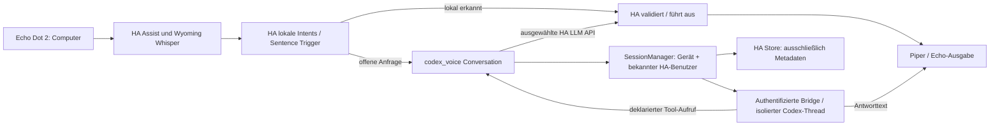

# Architecture

## Computer fork: normale Assist-Pipeline und Sitzungsgrenze



HA-ChatLog und ChatSession bleiben HA-eigene Framework-Objekte. Der Fork ändert
nicht die Satellite-Pipeline oder deren five-minute housekeeping. Er bindet
stattdessen die Bridge-ID pro Conversation-Profil stabil an Device-ID, alternativ
Satellite-ID. Bekannte authentifizierte HA-Benutzer werden zusätzlich getrennt.
Ohne ID: nur ausdrücklich konfiguriertes einzelnes Fallback-Gerät oder isolierter
Incoming-ID-Verlauf. Es gibt keine automatische Sprechererkennung.

`conversation_sessions.py` owns TTL, eine Queue von höchstens zwei Aufrufen pro
Owner, maximal 128 Sitzungen, RAM-Kontext (24 Nachrichten / 16.000 Zeichen),
Reset und primitive Store-Snapshots. Laufende TTL verwendet monotone Zeit,
persistierte Aktivität Wall-Clock-Zeit für Neustarts. `metrics.py` owns den
inhaltlosen 64-Turn-Ring; `conversation.py` bindet beides an die HA-Schnittstelle.
Die Bridge übernimmt TTL, periodische Thread-Bereinigung, authentifizierten
Reset und einen begrenzten Replay-Cache (letzte 2048 Request-IDs pro Prozess).

Neuer Thread: frühere erfolgreiche RAM-Turns einmal als untrusted Kontext
einfügen. Reused Thread: keine erneute Historien-Injektion. HA-Neustart: nur
Metadaten bleiben; Bridge-Thread kann noch existieren. Sind beide Kontexte weg,
wird dies gesprochen. Es gibt keinen persistenten Gesprächsmitschnitt und
keinen automatischen Wiederanlauf von Tool-Aktionen.

Trust boundaries bleiben erhalten: Gerät übergibt keine Tools, HA entscheidet
über LLM API/Exposure und validiert/führt Tools aus. Der Modellprozess erhält
keine Shell, fremden Dateien, MCP/Plugins oder HA-Zugangstokens. Memory ist aus.
Lokale HA-Intents laufen vor diesem Agenten und bleiben von dessen Bridge
unabhängig. B05 benötigt später verifizierte Targets; reine lokale Antworttexte
werden nicht als sichere Aktionsdaten übernommen. Siehe `future-changes.md`.

## Standard Assist pipeline

```text
ThirdReality Assist satellite
  -> Home Assistant Assist pipeline
     -> Wyoming faster-whisper STT entity
     -> Codex Voice Conversation entity
     -> Wyoming Piper TTS entity (external host, es_MX-ald-medium)
  -> ThirdReality speaker

Codex Voice Conversation
  -> authenticated HTTP/WebSocket bridge API
  -> Codex App Server over JSON-RPC/stdio
  -> Codex-managed ChatGPT login

Wyoming STT
  -> local persistent faster-whisper model

Wyoming TTS
  -> local persistent Piper model
```

The component is a normal Home Assistant integration with one parent config
entry. New entries create Conversation and subscription-backed TTS subentries;
Home Assistant's native Wyoming integration owns the reliable STT and
recommended TTS entities. The retained Codex TTS entity remains an explicit
experimental option. The retained Codex STT subentry is an explicit
experimental diagnostic because Codex realtime conversation does not provide a
deterministic finite transcription contract. The existing ThirdReality
satellite needs no firmware change for this turn-based mode.

Conversation turns use stable App Server thread and turn methods. Selected Home
Assistant LLM tools are advertised as dynamic tools. When Codex requests a tool,
the component executes it through Home Assistant's LLM API; the bridge has no
direct home-control authority. Conversation start and tool-result events are
encoded with Home Assistant's canonical JSON serializer, including nested
temporal values such as `date`, `time`, and `datetime`. Values outside that
policy are rejected locally with a data-safe protocol error before a WebSocket
message is sent.

The pinned v1.1.7 device overlay adds a second, explicitly separate route:

```text
"Okay Nabu" -> stock satellite protocol -> Home Assistant Assist/tools
"Okay Computer" -> in-process stdlib client -> realtime wire v2 -> bridge
                 -> conversation_mode: native
                 -> one native App Server WebRTC voice thread
                 -> local device playback

No Home Assistant broker snapshot, transcript executor, or appendSpeech render
handoff participates in the Okay Computer session.
```

The direct device remains an untrusted audio/control endpoint. It never
receives a Home Assistant credential, advertises tools, sends tool results, or
receives provider tool calls or transcript content. The current reference
client always requests native mode. The bridge ignores any registered realtime
authority for that session, so Okay Computer is tool-free; Okay Nabu owns Home
Assistant Assist and entity control. Qualified device AEC makes Okay Computer
the full-duplex/barge-in route. A normal Okay Nabu wake can preempt direct
mode and regain the microphone on the same vendor capture thread.

For legacy auto/managed compatibility, authority is selected from Conversation
config subentries, not from a device message. Zero or multiple opted-in
subentries disable registration; the
configuration flow also rejects a second authority. A successful registration
captures one immutable generation containing the rendered Home Assistant
instructions, an `es-MX`-by-default locale, and no more than 128 selected tools.
Each v2 provider session snapshots that generation. Schema, argument, result,
message, pending-call, and per-session-call limits are enforced on both sides;
an authority replacement, disconnect, timeout, correlation mismatch, or
undeclared provider tool fails closed without exposing the broker exchange to
the device.

## Legacy auto/managed realtime compatibility

The current ThirdReality client does not enter this route. It sends
`conversation_mode: "native"`, requires the bridge to echo that selection, and
therefore gets exactly one native App Server WebRTC voice thread. A native
session does not wait for a transcript, create an executor, or call
`thread/realtime/appendSpeech`.

The two-thread route remains for older strict-v2 clients that omit
`conversation_mode`. Under that compatibility policy it activates only when
all three inputs are present: App Server realtime version v3, a captured Home
Assistant broker snapshot, and an omitted conversation mode. A session without
all three inputs keeps native single-thread behavior. Codex CLI 0.147.0 or newer
is required because the managed route explicitly disables App Server's
delegation acknowledgement filler.

For the managed route, the bridge creates a tool-free realtime speech frontend
and a separate executor thread carrying the immutable Home Assistant context
and selected tools. The frontend receives immutable routing instructions plus
the bounded device language, voice-style, and brevity preferences. Its App
Server start sets `clientManagedHandoffs: true` and
`delegationAckFiller: false`. App Server v3 can route a native delegation before
the bridge observes a handoff notification, so prompts and client-managed
handoffs alone are not the security boundary; physical thread separation keeps
the provider-facing frontend unable to execute Home Assistant side effects.

```text
identified raw v3 user turn (or bounded v2 user text)
  -> bridge generation -> turn/start on isolated executor
  -> allowlisted tool call -> captured HA broker generation -> Home Assistant
  -> correlated result -> same executor turn
  -> completed final agent answer
  -> one <=500-byte UTF-8 appendSpeech on tool-free frontend
  -> session.context.appended for the same bridge generation
  -> unique assistant turn.created -> authorize and arm frontend PCM
  -> first authorized non-silent PCM -> begin speaking epoch
  -> matching assistant turn.done -> retire render -> device
```

Executor events are accepted only for the owned executor thread and active
turn. A bounded buffer handles events that arrive before `turn/start` returns.
The bridge prefers a completed `final_answer` agent message, otherwise the
latest completed non-commentary agent message, and never speaks an incomplete
or stale turn. A tool request from the frontend, a foreign or stale executor
turn, or a turn already tombstoned for interruption receives
`unowned_home_assistant_tool_call` with `do_not_retry: true`; it never crosses
the Home Assistant broker.

The frontend's provider audio is unauthorized by default. Only a completed
executor answer submitted through a single `thread/realtime/appendSpeech`
context frame, followed by the provider's `session.context.appended`
acknowledgement and a new identified assistant turn for the current generation,
can open the output gate. Only its matching `turn.done` retires the one-render
slot. Turn IDs are claimed for the socket lifetime across both roles, so replay
and role swapping cannot reopen command or audio authority. Direct frontend
answers, acknowledgements, late PCM, and stale-generation output stay blocked
or are dropped. Once a stale assistant render is identified as started,
provider cancellation is requested as a latency optimization; idle and merely
pending sessions are never cancelled. The local generation gate is the
authoritative suppression boundary.

## Isolated App Server profile and thread lifecycle

The bridge does not launch App Server against the user's everyday Codex home.
For each App Server process it creates mode-0700 temporary `HOME` and
`CODEX_HOME` directories and links only the existing managed ChatGPT
`auth.json` into that profile. File-backed CLI authentication is forced so a
Codex refresh updates the source credential through the link. The bridge
auto-detects `${CODEX_HOME}/auth.json` or `${HOME}/.codex/auth.json`; deployments
with another location can set `HA_CODEX_AUTH_FILE`. Startup fails if no secure,
file-backed credential is available.

This profile boundary keeps the user's normal Codex configuration, history,
apps, plugins, and MCP servers—including automatically discovered sidecars—out
of voice sessions. App Server's effective configuration layers are also
audited at startup; a configured MCP server aborts startup. No OAuth secret is
copied into Home Assistant or the repository.

Threads start with `ephemeral: false`, but their persistence is confined to the
temporary profile. This is intentional: App Server cannot apply
`thread/delete` to an ephemeral thread. The bridge deletes one-shot STT, TTS,
and realtime threads as soon as their session ends. A native device session
owns one realtime thread. A legacy broker-managed session owns both a frontend
and executor thread, and its cleanup disposes both
even if stopping or deleting the other resource fails. The bundled Home
Assistant component does not retain STT sessions for TTS, and the released
bridge never issues a handoff ticket. Dormant validation and ownership
machinery remains for future protocol work. Cached Conversation threads are
deleted when retired, evicted, or the bridge closes. Deletion unloads the
thread immediately instead of retaining it for App Server's idle-unload period.

## Experimental subscription audio adapters

Codex App Server does not expose independent subscription-backed STT or TTS
RPCs. The retained Codex TTS entity and experimental STT entity therefore
create short-lived realtime-conversation sessions:

1. Create an `aiortc` peer with a paced audio track and `oai-events` data
   channel.
2. Send the SDP offer to `thread/realtime/start` with realtime v3 and WebRTC
   transport.
3. Apply the answer returned by App Server.
4. Send or receive RTP audio and observe transcript events.
5. Stop and dispose of the session on success, timeout, cancellation, or error.

The active outbound track is required even for synthesis: a transceiver-only
offer negotiates successfully but the subscription service does not deliver
remote audio until outbound RTP activates the media path. Native media cadence
is 48 kHz, 16-bit PCM, 960 samples per 20 ms frame. Incoming WebRTC audio is
decoded from 48 kHz stereo, downmixed and resampled to 24 kHz mono PCM, and
returned to Home Assistant as WAV.

App Server's raw realtime WebSocket route is not used. In the pinned release it
requires API-key authentication, while the WebRTC call-creation path works with
Codex-managed ChatGPT OAuth and consumes ChatGPT subscription availability,
not OpenAI Platform API quota.

This App Server realtime surface is experimental and is not the documented
OpenAI Realtime API. Its methods, events, admission behavior, and latency may
change with Codex CLI/App Server. A native direct wake still performs cold
thread creation and WebRTC negotiation; single-thread routing removes the
bridge-created turn pipeline, not those startup costs.

## Reliable finite STT boundary

The production pipeline sends Home Assistant's bounded PCM16 stream to a local
Wyoming faster-whisper service. Home Assistant owns stream cancellation and
language selection; Wyoming keeps the model warm and returns one standard STT
result after capture EOF. This path does not open a Codex thread, consume a
subscription speech slot, or silently fall back to the experimental adapter.

```text
capture -> local Wyoming STT -> transcript -> Codex Conversation
        -> local Wyoming Piper TTS
```

See [reliable local speech-to-text](local-stt.md) for deployment and acceptance
checks.

## Reliable local TTS boundary

The recommended production pipeline sends the completed Conversation response
through Home Assistant's native Wyoming integration to a local Piper service.
For Mexican Spanish, the validated external service pins
`wyoming-piper==2.3.1`, keeps `es_MX-ald-medium` available, and listens on
`tcp://HOST:10200` after the operator replaces the loopback default with an
explicit trusted-LAN bind address.

The external deployment pins that voice to an immutable upstream revision.
An installer verifies exact sizes and SHA-256 digests before atomic placement,
and the private service runner verifies them again at startup. The hardened
unit exposes the model directory read-only and restricts Wyoming requests to
the single reviewed voice.

```text
Codex response text -> Home Assistant Wyoming client -> local Piper synthesis
                    -> PCM audio -> satellite playback
```

This stage does not create a Codex thread, use the subscription speech lane, or
send response text to a remote speech provider. The official Home Assistant
Piper add-on (shown as an app in current UI) is the simplest Home Assistant OS
path. On affected virtualized
x86-64 installations its current runtime may require the guest CPU model to
expose x86-64-v2 instructions; an external Wyoming Piper service is the
supported fallback when that guest CPU contract cannot be changed. This is a
bounded virtualization caveat, not a general requirement for every Piper
deployment or architecture.

See [reliable local text-to-speech](local-tts.md) for both setup paths,
pipeline selection, measurements, and acceptance checks.

## Experimental finite subscription adapter

When explicitly configured, the Codex STT provider opens
`/v1/transcribe/stream` before consuming the microphone iterator. After
validating the start message, the bridge starts the thread and WebRTC handshake
in a task while it continues receiving bounded PCM frames. Once sustained
speech supplies enough evidence for a bounded, one-time level calibration,
normalized audio is released to that task during capture. The bridge retains
the complete raw utterance for a same-path retry. Neither successful signaling
nor complete media delivery guarantees that the conversational backend emits a
user transcript, so this cannot serve as the reliable pipeline boundary.

The experimental lifecycle creates a fresh realtime resource per speech
operation. Automatic reuse is disabled because live v3 sessions emitted
assistant output before finite STT completion and the supported Frameless Bidi
outbound protocol has no response-cancel control.

```text
Experimental Codex STT active
  -> transcript result -> stop session -> delete thread
  -> experimental Codex TTS -> start fresh session -> stream speech
                            -> stop/delete
```

The dormant diagnostic handoff protocol uses a 256-bit single-use ticket. Its
design stores only a SHA-256 digest in the bridge; outside the authenticated
request/response transport, the raw value would remain in the component's
private in-memory context. The component-side design binds it to the exact
bridge client, Home Assistant `ChatSession` object, pre-STT TTS preparation,
voice, and normalized language. The bridge-side design also requires a matching
ticket digest, unexpired offer, compatible voice and language, no custom TTS
instructions, and an observed quiet boundary.

This would make reuse explicit rather than interpreting “the next TTS request”
as ownership. Calls without the marker preserved in the pipeline's prepared TTS
result—including ordinary direct `tts.speak` service calls, even in the same
chat session—take a fresh session. A mismatched or expired offer is cleaned
before the new cold session starts. If claimed reuse fails before the first PCM
leaves the bridge, synthesis can try the cold path within the original
deadline; it cannot restart after first PCM without risking duplicate speech.

The bundled component omits the private request, so STT and TTS always use
separate remote contexts. Diagnostic tickets remain bearer secrets and are
excluded from logs and diagnostics.

The bridge does not prewarm a remote session before a future wake word. A
custom STT provider has no reliable Home Assistant callback before wake
detection, an idle peer continues sending paced silent RTP, and a speculative
session would occupy the single subscription speech lane without a documented
quota-neutral idle lifetime. Experimental Codex adapter optimization is
therefore limited to capture overlap and progressive TTS delivery. The
recommended Wyoming providers do not use those remote adapters. The direct
device mode below begins only after its explicit wake; it is not a speculative
prewarm. See
[performance and ThirdReality tuning](performance.md) for the live measurements
and acceptance criteria.

## Realtime client mode

The bridge's `/v1/realtime` WebSocket is a project-owned LAN protocol, not the
App Server transport. Legacy v1 keeps its JSON/base64 compatibility behavior;
strict v2 accepts binary 16 kHz mono PCM16 input and returns binary 24 kHz mono
PCM16 only between explicit speaking-epoch controls. The bridge owns the
version-coupled App Server WebRTC peer and filters v2 events at that trust
boundary.

The pinned ThirdReality v1.1.7 overlay imports a standard-library-only client
inside the existing root voice process. It does not replace vendor modules or
add a second daemon. Its exact vendor bytecode guards are evaluated before any
patch is installed. A missing, disabled, insecure, or invalid root-only config
leaves direct mode inactive; unrecognized vendor code leaves all target methods
untouched.

```text
vendor microphone callback (16 kHz PCM16)
  -> static PulseAudio source for the configured AEC engine in full duplex
  -> direct-only idle pre-roll (up to 6 × 64 ms / 12 KiB in RAM)
  -> bounded device input/fallback queues (64 KiB / 2.048 s)
  -> paced v2 binary WebSocket (up to 2x while catching up)
  -> bridge v2-only WebRTC input cap (2,250 ms)
  -> conversation_mode: native
  -> one Codex App Server realtime v3 WebRTC voice thread

authorized provider audio (48 kHz WebRTC)
  -> bridge downmix/resample and content-free epoch gate (24 kHz PCM16)
  -> bounded device playback queue (48 KiB / about 1.024 s)
  -> fixed-argument paplay child pinned to the AEC sink and configured 1–60% stream volume (25% default)
```

The recorder callback runs before local wake-model activation. The overlay
therefore retains the newest six idle frames and atomically transfers them only
when Okay Computer selects the direct route. Okay Nabu discards that history
before official Assist starts. Stop, mute, disconnect, and teardown clear it,
and no copy is written to disk or logs. Pre-roll remains inside the configured
queue bounds and is trimmed or omitted to reserve at least 32 KiB (1.024 s) of
live post-wake capacity in both the direct input and pre-ready fallback queues.

The reference client requires `conversation_mode: "native"` in the bridge's
`started` acknowledgement. The bridge ignores any Home Assistant broker
snapshot for that session, so the diagram contains no transcript boundary,
executor turn, or `appendSpeech` render handoff. Omitted mode retains the legacy
automatic managed branch for older strict-v2 clients only.

The 2× transfer is bounded catch-up, not burst replay: it runs only while more
than one captured frame is queued and returns to capture cadence at the live
edge. It preserves accepted startup audio and prevents a permanent
handshake-sized delay, but cannot remove cold thread/WebRTC setup or provider
latency. The v2 2,250 ms input limit is applied per session before start;
finite STT retains its existing whole-utterance track capacity.

The client remains turn-taking by default: a speaking epoch gates microphone
submission until both its queued PCM and playback child have drained. Opt-in
full duplex requires a statically loaded PulseAudio `module-echo-cancel` with
the exact configured allowlisted `aec_method`, the reviewed raw hardware
masters, exact default AEC source/sink names, and the already-open vendor
capture stream routed through that source. Allowed methods are `webrtc`,
`speex`, and `adrian`. WebRTC remains the omitted-value default, and neither the
installer nor client automatically falls back. The observed stock v1.1.7 build
rejects WebRTC and Speex but loads Adrian with the exact masters and
`use_master_format=1`, producing 16 kHz mono endpoints; active stock-device
configuration therefore explicitly selects Adrian. A startup preflight verifies
the topology and configured 1–60% sink ceiling (25% default) before any microphone audio
leaves the device. The guarded installer also places the matching raw sink
value immediately after AEC sink creation in the static PulseAudio startup
block. The stock voice process later reapplies the persistent Home Assistant
media-player preference, so deployments keep that later writer at the same
value and do not depend on deferred device-restore state. The ceiling is
rechecked at every `speaking.started`, and
every `paplay` child is pinned to the AEC sink with a fixed stream volume at or
below that ceiling. The Adrian topology result does not replace physical
double-talk qualification for each installation at its configured sink and
stream values; the reference device passed the bounded 25% echo-residual and
staged barge-in canaries, which do not qualify an explicit increase up to 60%.

In verified full duplex, provider VAD continues receiving capture during
playback. Two consecutive qualifying AEC-filtered microphone frames request a
local flush for the exact active output epoch; the network thread aborts the
player and quarantines late PCM without pausing upstream audio. Provider
`input_audio_buffer.speech_started` independently reinforces that boundary.
Neither event itself proves provider cancellation. The bridge truthfully keeps
`remote_cancel: false` and separately advertises
`same_session_interrupt_ack: true`.

In the legacy broker-managed two-thread compatibility path, every new speech
boundary or accepted user message advances the bridge generation and revokes
prior output. The
bridge requests frontend cancellation only if an identified assistant render
has actually started. If the active executor turn has not
dispatched a Home Assistant tool, the bridge tombstones it before sending
`turn/interrupt`, waits for its terminal event, and rejects any late tool call.
If a tool has already crossed the broker boundary, the bridge does not cancel
or retry that potentially side-effecting turn. It lets the result settle,
suppresses the stale final, and runs the newest queued request afterward.

The current client advertises support with the exact HTTP header
`User-Agent: ha-codex-voice-thirdreality/2`. If an older omitted-mode client
selects managed behavior, that header enables an interruption response with
`fresh_session_required: false`,
`remote_cancelled: false`, and `continuation_safe: true`: continuation is safe
because the bridge invalidated its executor/output generation, not because the
provider confirmed cancellation of the tool-free frontend. An older client
does not advertise that contract, so the bridge returns the established
fresh-session fallback, closes the socket, and disposes both owned threads.
The current native path requires a provider
`response.cancelled` event whose identifier matches the active response;
timeout, mismatch, completion, or ambiguity tears the session down.

The device stores a distinct route-scoped bearer in a root-owned mode-0600
file. The bridge accepts it only on `/v1/realtime`; the primary Home Assistant
bridge token, ChatGPT credential, and Home Assistant token do not go to the
speaker. The device bearer cannot open the tool-authority route; Home Assistant
uses the primary bridge token for that outbound connection. See the [wire
protocol](../protocol/realtime-wire-v2.md) and [device deployment
contract](../device/thirdreality/README.md).

ThirdReality v1.2 is a native C++ rewrite with a changed audio, AEC, playback,
and continued-conversation path; it is not merely a drop-in performance flag.
The target is single-slot, so upgrade testing needs a separate canary device,
complete partition/data/environment read-backs, authenticated image provenance,
and a physically rehearsed full-image downgrade and restoration; flashing the
only production speaker is not an A/B test. Its v1.2.1 image also exposes
unauthenticated root ADB on TCP port 5555 and password-authenticated root SSH
with a documented default; both services must be isolated, hardened, and
re-verified after reboot and updates. The safe settings, canary matrix,
recovery checklist, and access-service requirements are documented in
[performance and ThirdReality
tuning](performance.md#official-v12-c-firmware-canary-evaluation).

The v1.1.7 in-process overlay does not require this firmware canary. It neither
starts nor stops `adbd`; deployment, restart, rollback, and reboot verification
must preserve the approved TCP ADB port 5555 recovery path.
